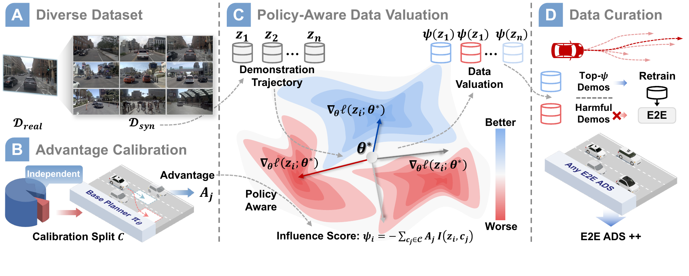
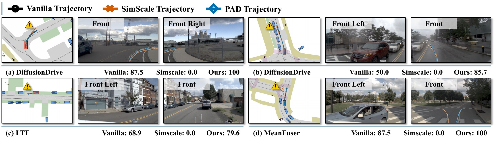

<p align="center">
  <a href="https://perfectxu88.github.io/PAD/">
    
  </a>
</p>

<h1 align="center">PAD: Policy-Aware Data Valuation for Autonomous Driving</h1>

<p align="center"><strong>Select the demonstrations that improve your driving policy.</strong></p>

<p align="center">
<a href="https://perfectxu88.github.io/">Chengkai Xu</a><sup>1</sup>, Yicheng Guo<sup>1</sup>,<br>
Jiaqi Liu<sup>2</sup>, Yiming Cui<sup>1</sup>, Shiyu Fang<sup>1</sup>, Peng Hang<sup>1</sup>, Hao Zhang<sup>3</sup>, Jian Sun<sup>1</sup>
</p>
<p align="center">
<sup>1</sup> College of Transportation, Tongji University<br>
<sup>2</sup> Department of Computer Science, UNC Chapel Hill<br>
<sup>3</sup> Department of Control Science and Engineering, Tongji University
</p>

<p align="center">
<strong><a href="https://perfectxu88.github.io/PAD/">🌐 Explore the Project Page</a></strong> &nbsp; &middot; &nbsp;
<a href="docs/README.md">📖 Documentation</a> &nbsp; &middot; &nbsp;
<a href="https://perfectxu88.github.io/">💬 Contact Me</a>
</p>

<p align="center">
<a href="#how-pad-works">💡 Method</a> &nbsp; / &nbsp;
<a href="#the-right-data-for-your-policy">🎯 Why PAD</a> &nbsp; / &nbsp;
<a href="#highlights">✨ Highlights</a> &nbsp; / &nbsp;
<a href="#stronger-driving-with-less-synthetic-data">📈 Results</a> &nbsp; / &nbsp;
<a href="#getting-started">🚀 Getting started</a> &nbsp; / &nbsp;
<a href="docs/reproduction.md">📖 Reproduction guide</a>
</p>

<a id="how-pad-works"></a>

## 💡 How PAD works



<a id="the-right-data-for-your-policy"></a>

## 🎯 The right data for your policy

**The value of a driving demonstration depends on the policy learning from it.** A large synthetic pool offers diverse experiences, but treating every demonstration equally misses a crucial question: *which examples will actually improve this planner?*

PAD makes data selection **policy-aware**. It connects a target policy's driving outcomes with the learning signal of each demonstration, turning a shared synthetic pool into a training set tailored to that policy.

<table>
<tr>
<td align="center" width="33%"><h3>88.3 EPDMS</h3>DiffusionDrive on NavTest<br><strong>+3.5</strong> over real-only training</td>
<td align="center" width="33%"><h3>25% of the pool</h3>Higher NavTest EPDMS than<br>training with all synthetic data</td>
<td align="center" width="33%"><h3>3 policy families</h3>DiffusionDrive &middot; LTF &middot; MeanFuser<br>One policy-aware valuation framework</td>
</tr>
</table>

<a id="highlights"></a>

## ✨ Highlights

- **Policy-specific value.** Real driving outcomes identify the demonstrations that matter to each planner.
- **Scalable influence.** Projected gradients and regularized local geometry score the candidate pool with one linear solve.
- **Three policy families.** Select a compact dataset, then train DiffusionDrive, LTF, or MeanFuser with its native objective.
- **Rankings backed by retraining.** Group-removal effects align with PAD values (**Spearman rho = -0.900**).

<a id="stronger-driving-with-less-synthetic-data"></a>

## 📈 Stronger driving with less synthetic data

**DiffusionDrive reaches 88.3 EPDMS with just one quarter of the synthetic pool**, surpassing both real-only training (84.8) and full-pool augmentation (85.9). PAD also improves LTF and MeanFuser beyond their full-pool results, demonstrating the value of matching data to the learner.

| Policy | Real only | Full synthetic pool | **PAD** | Synthetic data retained |
| --- | ---: | ---: | ---: | ---: |
| DiffusionDrive | 84.8 | 85.9 | **88.3** | **25%** |
| LTF | 79.1 | 84.4 | **85.9** | 75% |
| MeanFuser | 84.2 | 84.8 | **87.1** | 75% |

**The gains extend to challenging driving scenarios.** On NavHard, the best PAD configurations achieve **32.9 / 30.8 / 30.7** EPDMS for DiffusionDrive / LTF / MeanFuser, gains of **5.0 / 7.8 / 6.1 points** over their real-only baselines.

## 🚘 See the driving behavior



<a id="getting-started"></a>

## 🚀 Getting started

```bash
conda env create -f environment.yml
conda activate pad
pip install -e .
export PYTHONPATH="$PWD:${PYTHONPATH:-}"
```

Choose your policy and follow the [reproduction guide](docs/reproduction.md) to prepare data, compute values, select demonstrations, and train. Full environment setup is included in that guide.

| Policy | Valuation entrypoint |
| --- | --- |
| DiffusionDrive | `python -m influence.compute_psi` |
| LTF | `python -m influence.compute_psi_ltf` |
| MeanFuser | `python -m influence.compute_psi_meanfuser` |

[**Reproduction guide**](docs/reproduction.md) &nbsp; [Data setup](docs/install.md) &nbsp; [Download helpers](download/)

## 🤝 Acknowledgements and license

PAD builds on [NAVSIM](https://github.com/autonomousvision/navsim), [SimScale](https://github.com/OpenDriveLab/SimScale), [DiffusionDrive](https://github.com/hustvl/DiffusionDrive), [TransFuser](https://github.com/autonomousvision/transfuser), and [MeanFuser](https://github.com/wjl2244/MeanFuser). We thank their authors for making their code and resources publicly available.

Please refer to the respective repositories for their licenses. See the [documentation](docs/README.md) for installation, data preparation, and reproduction instructions.
